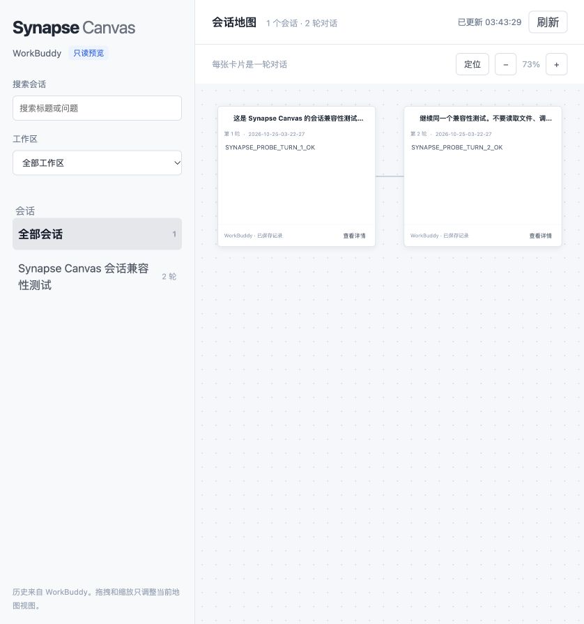

# Synapse Canvas

面向多 Harness 的可视化对话工作台，计划从 CodeBuddy / WorkBuddy 适配开始发展。

## 项目来源与致谢

本项目基于 [liangmianya/dsh-synapse](https://github.com/liangmianya/dsh-synapse) 开发，感谢原作者 liangmianya 的设计、实现与支持。

本项目的初始代码，包括对话地图与画布交互、DSH 会话接入与事件投影、布局存储、测试及相关文档，继承自 dsh-synapse。感谢原作者及上游贡献者完成这些基础工作，并感谢原作者支持 CodeBuddy / WorkBuddy 适配方向。

Synapse Canvas 是独立维护的衍生项目，保留上游提交历史和 MIT 许可证。原项目贡献归原作者及相应贡献者所有，后续开发与发布由本项目维护者负责。

导入基线：dsh-synapse `0.5.0`，提交 `265d7ff1f41c87e41f5648166e410cbf972c417f`。

详细来源与贡献边界见 [NOTICE](NOTICE)，原有版权与许可声明见 [LICENSE](LICENSE)。

## 当前状态

当前包含上游 DSH 插件、**WorkBuddy 本地会话只读地图**及可在 WorkBuddy 任务中加载的 **MCP App**。已开始提取公共会话模型与平台事件适配边界。内嵌画布可发送所选问答引用到当前任务；向选定源会话追问、原生分叉及 CodeBuddy 接入尚未完成。

现有包配置仍使用上游名称 `dsh-synapse`，独立包名和发布流程将在后续开发中调整。

## WorkBuddy 内嵌画布

已在 macOS WorkBuddy 5.9.2 企业版验证。安装依赖并构建后，将 [MCP 配置示例](mcp/config.example.json)中的路径改为本机绝对路径，在 WorkBuddy 自定义连接器中保存、信任并启用，然后调用 `show_canvas`。

详细步骤及能力边界见[应用内嵌入说明](docs/workbuddy-embedding.md)。


## WorkBuddy 只读地图

需要 Node.js `>= 22.19.0` 和本机 WorkBuddy 历史。使用已有测试任务启动：

```sh
npm run preview:workbuddy -- --marker SYNAPSE_CANVAS_PROBE_20261025
```

打开终端输出的完整预览链接。地图支持会话和工作区筛选、按标题或问题搜索、卡片拖动、平移缩放、详情查看，以及每两秒刷新已保存的记录。
默认只读取带指定标记的有效本地会话；其他读取范围及限制见[使用说明](docs/workbuddy-preview.md)。



## 开发

需要 Node.js `>= 22.19.0`。

```sh
corepack pnpm install --frozen-lockfile
corepack pnpm run build
corepack pnpm test
```

## 文档

以下文档继承自上游，当前描述 DSH 实现：

- [中文指南](docs/zh-CN/README.md)
- [English guide](docs/en/README.md)
- [架构与边界](docs/architecture.md)
- [开发与发布](docs/development.md)

本项目的适配验证记录：

- [WorkBuddy 首轮能力验证](docs/workbuddy-validation.md)
- [WorkBuddy 只读地图使用说明](docs/workbuddy-preview.md)
- [WorkBuddy 应用内嵌入与交互验证](docs/workbuddy-embedding.md)
- [公共模型与适配边界](docs/multi-harness-architecture.md)

## 许可证

[MIT](LICENSE)。保留原项目的版权与许可声明。
