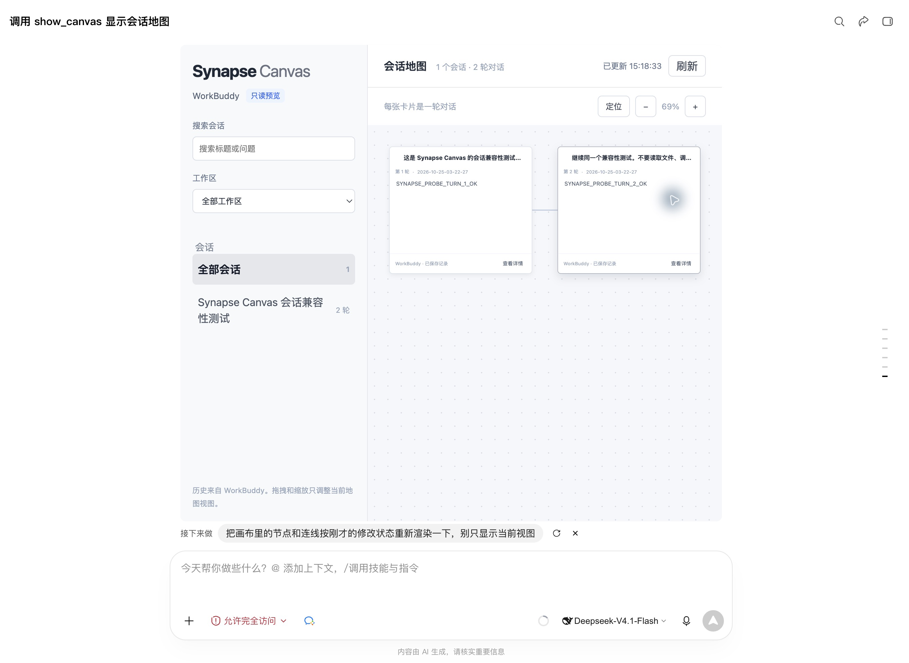

# WorkBuddy 应用内嵌入

2026-10-25，已在 macOS WorkBuddy 5.9.2 企业版中实际加载 Synapse Canvas MCP App。画布显示在任务对话内，可激活交互、搜索、缩放、查看详情，并通过 MCP 资源每两秒刷新已保存的历史。



截图仅包含专用测试任务，已裁去宿主的私人项目侧栏。

## 安装与打开

需要 Node.js `>=22.19.0`、pnpm，以及本机 WorkBuddy 历史。先创建首个问题带独立标记的测试任务；已有测试标记为 `SYNAPSE_CANVAS_PROBE_20261025`。

在仓库根目录执行：

```sh
pnpm install --frozen-lockfile
pnpm run build
```

构建会生成 `mcp/widget.html` 和依赖许可清单；这些生成文件不提交 Git。`pnpm-workspace.yaml` 仅允许 esbuild 的构建脚本。

在 WorkBuddy「专家·技能·连接器 → 连接器 → 自定义连接器」中添加本地 MCP 服务。参考 [配置示例](../mcp/config.example.json)，将脚本路径改为本机仓库的绝对路径。若 GUI 找不到正确版本的 Node，将 `command` 也改为 Node 可执行文件的绝对路径。

合并配置时保留其他服务，保存后返回 MCP 列表，信任并启用自己构建的 `synapse-canvas`。当前实测显示 `1/1 个工具已启用`。仅修改配置文件未能激活服务，必须在宿主界面保存并启用。

在单独的测试任务发送：

```text
请仅调用 synapse-canvas 的 show_canvas，显示会话地图。不要调用其他工具。
```

画布出现后，点击宿主的「激活 MCP App 以交互」。更新代码后重新构建，再禁用、启用该连接器并重新调用工具；本次实测中，仅重新调用工具仍使用了宿主缓存的旧界面。

无需启动 HTTP 预览服务。移除集成时，只在 MCP 管理中禁用或移除 `synapse-canvas`，保留其他服务。

## 已验证的边界

| 项目 | 实测结果 |
| --- | --- |
| 应用内加载 | 原生任务中显示 MCP App，1 个测试会话、2 轮问答 |
| 读取和交互 | 详情正文、搜索结果与清空恢复、缩放、资源轮询成功 |
| 发送引用到当前任务 | MCP `ui/message` 将所选问答作为新用户消息发到承载画布的任务，并触发助手回复 |
| 仅回填输入框 | 未支持；携带 `codebuddy.ai/sendMessageMode: fill` 仍实际发送。独立检查确认 SDK 保留了该元信息，因此当前链路不能据此承诺仅回填 |
| 全屏展开 | 未观察到宿主布局展开，最终界面不提供该按钮 |
| 向地图中选定的源会话追问 | 未验证；发送引用到当前任务不能证明源会话控制可用 |
| 从指定回答处原生分叉 | 未验证，保持不可用 |

最终引用按钮明确写为「发送引用到当前任务」，并说明会触发助手回复。问题最多引用 4,000 字符，回复最多引用 8,000 字符；截断时明确标注。它复制所选问答作为上下文，不延续源会话的原生身份、完整历史或工具状态。

发送实验在单独的承载任务中完成。原始「Synapse Canvas 会话兼容性测试」仍保持两轮，源会话能力中的 `send`、`fork` 仍为 `false`。

## 实现与范围

- `mcp/server.js` 通过 stdio 提供 `show_canvas`、UI 资源和受限的数据资源；工具不接受参数，不能由模型更改读取范围。
- 服务启动时按 `--marker` 或显式 `--account` 确定会话集合，并固定集合直到服务重启。集合内的记录可更新，已删除或不再有效的记录仍由读取器过滤。
- 工具结果只返回会话与轮次数量；正文通过 MCP 资源供界面读取。模型若主动读取数据资源，仍可能获得该范围内的正文；这是数据最小化，不是模型隔离保证。
- `preview/view.js` 是 HTTP 预览与 MCP App 共用的画布视图；数据截断复用 `core/read-only-payload.js`。
- 官方 MCP Apps SDK 与界面代码打包在单一 HTML 中，以 gzip 压缩后在浏览器内解压，保持在 256 KiB 预算内。无 CDN、外部字体、外部脚本或额外网络连接域；保留项目来源与所打包依赖的许可证。
- 不修改 WorkBuddy 安装包或历史数据库；宿主消息仅由明确的用户点击触发。没有开放源会话写入工具。

历史解析限制沿用[只读地图说明](workbuddy-preview.md)。这里的结果仅证明当前 WorkBuddy 版本的实际行为，CodeBuddy 仍需单独验证。
