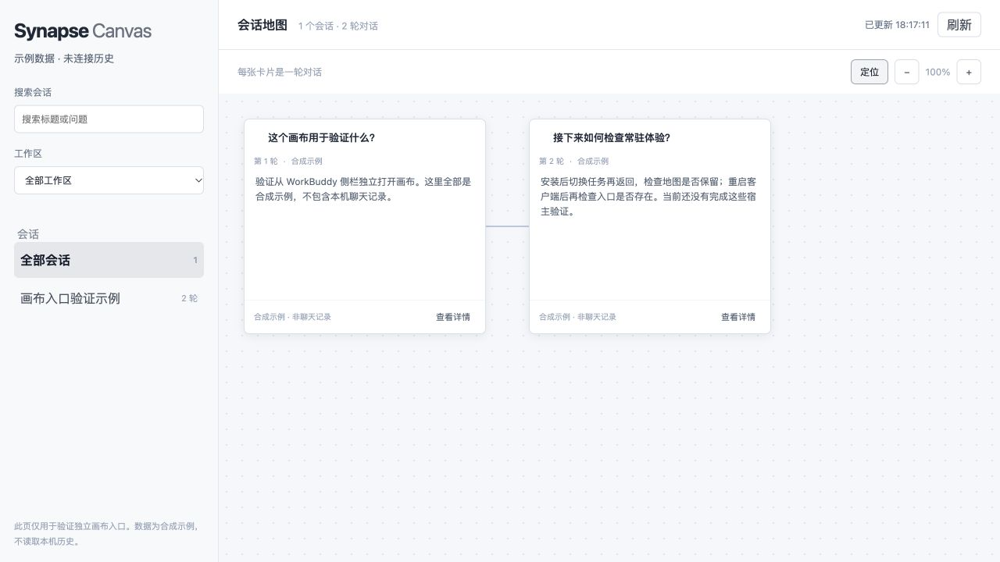

# WorkBuddy 独立画布入口验证

2026-10-25，目标是从客户端导航独立打开画布，再验证跨任务保持与重启后的入口恢复。当前状态：已准备网页验证包，尚未注册到宿主侧栏；浏览器预览通过不代表常驻安装成功。

## 可用路径与证据

| 路径 | 已确认的能力 | 尚需条件或验证 |
| --- | --- | --- |
| 企业客户端自建菜单 | 官方文档明确支持通过 iframe 将自有 Web 系统接入导航，URL 必须是 HTTPS | 企业后台配置权限、页面托管地址及下发范围；未实际发布 |
| Buddy 应用网页菜单 | 官方文档的搜索索引描述网页 ZIP、`pages` 清单和侧栏菜单；可下载的官方示例包确有此格式 | 开放平台可配置的应用及对应预览入口；本次直接访问文档仍返回较旧正文，需以实际后台为准 |
| 普通插件 / MCP | 已有对话内 MCP App，插件可打包分发相关能力 | 未确认能注册应用级导航页面 |
| 内部 UI Extension | 本机包中存在页面入口、`keepAlive`、签名分发实现 | 未获得第三方 SDK、签名及开发加载契约，未尝试绕过 |

官方参考：

- [企业客户端定制](https://cloud.tencent.com/document/product/1831/139908)
- [Buddy 应用](https://open.workbuddy.cn/docs/buddy-app)
- [官方网页资源包示例](https://codebuddy-platform-1258344699.cos.ap-beijing.myqcloud.com/open/static/files/%E7%BD%91%E9%A1%B5%E8%B5%84%E6%BA%90%E5%8C%85%E7%A4%BA%E4%BE%8B.zip)

本机实查「更多 → 自定义菜单栏」只能整理已有菜单，没有新增网页入口。没有修改客户端安装包、内部扩展注册信息或企业配置。

## 最小验证包

构建依赖为已安装的项目 Node.js / pnpm 依赖与 Python 3 标准库：

```sh
pnpm run buddy:package
```

输出目录：`dist/buddy-menu/`；上传候选文件：`dist/synapse-canvas-buddy-demo.zip`。

仅在浏览器检查包内页面时，可从仓库根目录运行 `python3 -m http.server 4318 --bind 127.0.0.1 --directory dist/buddy-menu`，访问 `http://127.0.0.1:4318/`。这不是侧栏安装步骤。

ZIP 根目录包含 `manifest.json`、`index.html`、`assets/app.js`、`assets/styles.css`、`LICENSE`、`NOTICE`。只打包清单列出的文件，保留原项目署名和许可证，不会把整个工作目录装进 ZIP。

包中只有一个合成会话和两轮问答。复用公共画布，但不导入本地历史读取器，不请求 MCP、HTTP API 或其他外部数据，不提供消息发送入口。它用于验证页面承载方式，尚不具备真实会话功能。



已在浏览器中检查加载、详情、搜索无结果与清空恢复、缩放。自动检查覆盖资源声明、依赖边界、署名保留、未声明文件排除与路径越界拒绝。

### 有 Buddy 应用配置权限时

1. 在自己的测试应用中查找网页菜单 / 网页资源包配置，上传上述 ZIP。
2. 页面 ID 为 `synapse-canvas`；菜单文案建议中文「会话画布」、英文「Conversation Canvas」。文案在后台填写，不伪造未公开的应用配置 JSON。
3. 使用平台提供的预览入口在匹配版本客户端打开，先不发布到企业或公共市场。
4. 如果后台缺少该配置或拒绝资源包，记录具体版本与错误，确认是否需灰度权限。不要将文件直接复制到内置扩展目录。

### 有企业管理权限时

将同一静态目录托管到受控 HTTPS 地址，在「客户端配置 → 客户端定制 → 导航菜单」新增自建菜单。这里的发布可能影响企业成员，必须先明确测试范围。当前未选择托管服务、上传页面或发布企业菜单。

现有 `http://127.0.0.1` 私有历史预览不能直接作为这一 HTTPS 配置的成品。本次不改动其来源校验或鉴权。

## 宿主验收

以下项目目前全部待验证：

- 不发送提示词、不调用模型，点击侧栏入口即可打开画布。
- 离开当前任务或关闭承载过 MCP App 的任务，侧栏入口仍可用。
- 调整缩放或卡片位置，切换任务再返回，检查状态保留；页面的 `data-synapse-instance` 可辅助区分保活与重新挂载。
- 退出并重新启动 WorkBuddy，检查入口是否仍存在。自动打开页面、内存保活、持久入口是分别验收的行为。
- 窄窗口、深浅主题以及页面异常后的重新打开。

通过入口验收后，再单独设计真实历史的数据通道。普通网页菜单不能直接沿用 MCP App 的 `readServerResource`；公开的授权码或主题 API 也不能据此推断拥有本地开发任务的历史控制权。

## 需要官方确认的问题

1. 普通个人开发者能否使用 Buddy 应用网页菜单？是否需要单独灰度权限？
2. 是否提供本地开发加载方式、最小应用配置和预览版本要求？
3. 自定义菜单的保活、切换任务、主题与启动恢复契约是什么？
4. 菜单页面能否通过公开 API 访问经用户选择授权的本地开发任务历史？
5. `.wbext` UI Extension 是否向第三方开放？如开放，SDK、签名和分发入口是什么？

这些问题尚未发给官方；本次只准备接入材料与验证包。
